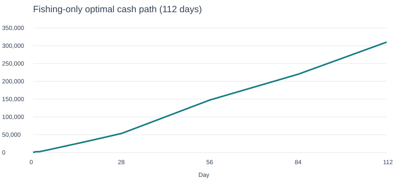

# Fishing module / 钓鱼模块

已包含输入数据、完整数学规格、可运行 MILP、独立核查、测试与实际求解结果。基线严格沿用既定设定：112 天、初始 500g、每日 900 游戏分钟和 270 体力，最大化年末现金。

**HiGHS 已求得期末现金 310,173.28g，Optimal，MIP gap=0。** 一份最优解在 Day 2 购买 Fiberglass Rod、Day 4 首次使用鱼饵，不买 Iridium Rod、不用吊钩。该购买日及部分时段分配可能存在多个等价最优选择。全年 4,211 竿，毛收入 317,963.28g，鱼竿支出 1,800g，鱼饵支出 6,490g；最终现金含初始 500g。

| 季节 | 最优解的地点安排 | 季末现金 |
| --- | --- | --- |
| Spring | Mountain Lake 白天、Ocean 夜间 | 53,535.76g |
| Summer | Ocean，按时段混用 none 与 bait | 147,520.55g |
| Fall | Town River 白天、Ocean 夜间 | 220,078.16g |
| Winter | Mountain Lake | 310,173.28g |

## 快速运行

需要 Python 3.10+，在仓库根目录执行：

```bash
python -m pip install -r fishing/requirements.txt
python fishing/src/fishing_milp.py --horizon 112 --time-limit 180 --gap 0
python fishing/src/fishing_validate.py fishing/results/baseline_112
python -m unittest discover -s fishing/tests -v
```

默认使用无需许可证的 HiGHS。另提供 `--backend gurobi` 以便与种植、采矿工具一致，但需另装 gurobipy 与足够规模的许可证；**本次实际验证使用 HiGHS，未实测 Gurobi 适配入口**。完整命令、实验口径、算法简化证明和接口边界见运行说明。

## 文件导航

| 阅读目的 | 文件 |
| --- | --- |
| 先了解游戏机制与决策 | [独立优化说明](docs/钓鱼模块_独立优化说明.md) |
| 查看输入字段和兼容关系 | [数据使用指南](docs/钓鱼模块_数据使用指南.md) |
| 核对完整式子 | [模型 Markdown](docs/钓鱼模块_完整设定与数学模型_更新版.md) / [PDF](docs/钓鱼模块_完整设定与数学模型_更新版.pdf) / [LaTeX](docs/钓鱼模块_完整设定与数学模型_更新版.tex) |
| 运行、复现及代码映射 | [代码运行与实现对照](docs/钓鱼模块_代码运行与实现对照.md) |
| 报告正文、课堂对应、策略与局限 | [Methodology 与结果分析](docs/钓鱼模块_Methodology与结果分析.md) / [PDF](docs/钓鱼模块_Methodology与结果分析.pdf) |
| 组员审核与联动 | [约束审核与联动接口](docs/钓鱼模块_约束审核与联动接口.md) |
| 求解器与实验代码 | [src/](src/) |
| 完整逐日最优操作 | [daily_schedule.csv](results/baseline_112/daily_schedule.csv) / [activity_schedule.csv](results/baseline_112/activity_schedule.csv) |
| 最优性证据与可行性核查 | [summary.json](results/baseline_112/summary.json) / [validation.json](results/baseline_112/validation.json) / [solver.log](results/baseline_112/solver.log) |
| 禁购装备、固定地点、资源份额对照 | [comparison_summary.csv](results/comparison_summary.csv) |



## 机制与实现边界

- 每竿（含非鱼）计 1 次经验，等级次日生效；日初现金支付，当日收入日末到账。
- bait 接受 Fiberglass 或 Iridium；Dressed Spinner 等级 8；鱼竿当日可买可用。
- 预期毛收入已含非鱼；时间已包含装备效果，不再次减半；吊钩仅预期损耗摊销。
- 保留原始数据与完整公式；实现用等价等级区间消去 u，并仅删除严格受支配活动以减小模型。解释与证明见运行说明，`--no-prune` 可关闭删列。
- 7 项测试通过；全年基线和所有对照解都由独立程序重算现金、资源、等级及装备资格。结果是当前确定性设定下的最优值，不是实际游戏逐竿保证。
- 100k 的 Day 42 仅为年末最优路径上的首次跨越日，不是已求解的“最早达标”问题。
- 尚未完成三模块联合求解。共享输入只读；本次只提交 fishing/，不改 planting、mining 或 shared。

报告复现：先运行 `python fishing/src/run_fishing_experiments.py --time-limit 180 --gap 0`，再运行 `python fishing/src/generate_fishing_report.py`。如需重建结果分析 PDF，另装 `reportlab` 后在后一命令添加 `--pdf`。数学模型 PDF 的 LaTeX 排版源已一并提供。
